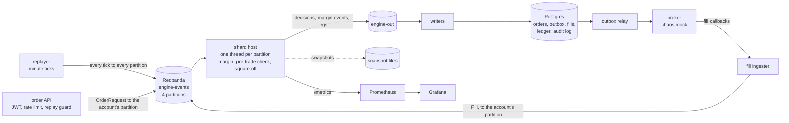

# Real-Time Margin & Risk Engine

A deterministic, sharded margin engine for Nifty index derivatives. It computes SPAN-style margin for every account on every market tick, checks orders before they are accepted, and squares off accounts that run out of margin, exactly once each, through a broker that misbehaves on purpose. It is replayed against the 4 June 2024 election-result crash, when the Nifty 50 fell almost 9% intraday and India VIX reached 31.7.

Plain Java 21 in the hot path; Redpanda as the ordered log; Postgres as a projection; a Spring Boot order API in front.


## Headline numbers

From [docs/results.md](docs/results.md), where every number names the command that produced it. All measured on one fanless laptop (MacBook Air M4).

| | |
| --- | --- |
| Accounts, shards | 100,000 accounts × ~5 positions, 4 shards |
| p99 tick-to-margin | **under 50 ms at 100,000 accounts and 50 ticks/s** (15.7 and 35.8 ms over 2-minute runs, snapshots on). 100 ticks/s does not hold reliably on this laptop and is not claimed |
| Incremental recompute | 27.4× faster than naive, 3.1× faster than a full recompute, per tick |
| Concurrency | **0 mismatches** over 1,000,000 interleaved ticks, orders, fills and closes, against a single-threaded reference engine |
| Square-off under broker chaos | **0 legs closed twice**, 0 surplus legs, every ledger transaction sums to zero (5% timeouts, 2% rejects, split and late fills, 10% duplicate callbacks) |
| Recovery | after 6 × `kill -9` mid-square-off, **4 of 4 shards' state hashes identical** to an uninterrupted replay, 0 duplicate broker orders; about 6 s to recover 100,000 accounts from snapshots |
| Crash day, 100,000 accounts | **23,662 warned, 13,350 margin-called, 8,710 squared off** (9,077 legs) between 09:24 and 12:28 IST; no account lost more than it had. [Report](docs/crash-day-2024-06-04.md) |

## Run it

Needs Docker (with compose), a JDK 21+ and curl.

```bash
git clone https://github.com/Panavdoesstuff/risk_engine.git
cd risk_engine
./scripts/demo.sh
```

`demo.sh` builds the image, brings up everything in docker compose (Redpanda, Postgres, Redis, the shard host, writers, outbox relay, a chaos broker, the order API, Prometheus, Grafana), opens the Grafana dashboard and replays 4 June 2024 one minute every 150 ms. You watch the Nifty fall, VIX rise, and margin calls and square-offs fire; at the end it prints what happened and leaves the stack running (`docker compose -p risk-demo --profile app down -v` stops it). The first run spends a few minutes building.

**Market data is not in the repo.** Without it the demo uses clearly labelled synthetic prices. To replay the real day, put the NSE bhavcopy and Upstox minute candles in `data/raw/` ([data/README.md](data/README.md)); the crash-day report is then `./gradlew :report:crashDay`.

Other entry points: `./gradlew build` (all tests; the Redpanda, Postgres and API tests start their own containers), `./scripts/m4-e2e.sh` (the end-to-end check CI runs), `./gradlew :loadtest:stress`, `./gradlew :loadtest:scale`, `./scripts/k6-orders.sh`.

## Architecture



- **One ordered log per shard, no locks.** An account lives on one partition (`murmur2(accountId) % 4`), and one thread applies that partition's events strictly in order: ticks, orders, fills, risk-ops actions. Same log in, same state out, bit for bit: every shard has a SHA-256 state hash, and replays, recoveries and the stress test compare them.
- **Incremental margin.** Each tick reprices each held instrument once (16 SPAN scenarios), and each holder's account vector moves by `qty × (new − old)`. 1% of accounts are rebuilt from scratch on every tick and checked to the paisa.
- **Postgres is a projection** of `engine-out`, written idempotently, so the engine can replay without corrupting it. The log plus snapshots is the source of truth.
- **Exactly-once square-off on an at-least-once pipeline:** a leg's key `accountId:episodeId:instrumentId:seq` is its order id, its outbox key and the broker's dedupe key.

More: [docs/architecture.md](docs/architecture.md); every design choice with its reason and cost: [docs/decisions.md](docs/decisions.md).

## How an order is checked without locks

`POST /orders` does not decide anything. It checks who you are and that the request is well formed, writes an `OrderRequest` to the partition that owns your account, and answers **202 Accepted** with an order id. One shard thread owns that partition. It applies the partition's events strictly in order: every market tick, your fills, your orders. When it reaches your order, your account's state is exactly "everything before this order in the log", and no other thread can touch it, so the margin check is a plain calculation. The shard publishes ACCEPTED or REJECTED (with a reason) to `engine-out`, and `GET /orders/{id}` shows it.

Accepted orders reserve their margin until they fill or are closed, so two orders sent back to back can't spend the same money.

Tokens are JWTs signed with HS256 and a shared secret (`JWT_SECRET`); the API only verifies them. **`docker-compose.yml` sets a fixed development secret when `JWT_SECRET` is unset. It is for a laptop only: anyone with the file can mint tokens for any account. Set your own secret anywhere shared.** If a separate login service is ever added, the upgrade is RS256: the login service signs with a private key and the API verifies with the public one, so the API can no longer mint tokens. Grafana in compose is dev-only too (anonymous viewing, default admin password). Details: [docs/decisions.md](docs/decisions.md) #48–#54.

## How a square-off works

When an account stays at 120% utilisation or more for three ticks, its shard opens a square-off episode. It plans **one** closing leg (short options first, then futures; the fewest lots that bring it back under 100%), records it as in flight, and publishes it. The writers store the leg as an order plus an outbox row in one transaction; the relay sends it to the broker under its key; the broker's fills come back through the fill ingester into the account's partition. Only when the leg has filled (or been rejected, which re-plans with `seq + 1`) does the shard plan the next one. Utilisation used for the decision is *expected* utilisation, with the leg in flight counted as done, so it never sends more while one is out. Every fill that moves cash is booked as two ledger rows that sum to zero. Risk-ops can block, unblock or square off an account through the API; that, too, is an event in the account's partition. Details: [docs/decisions.md](docs/decisions.md) #72–#86.

## Limits

- **One volatility for every strike and expiry** (India VIX ÷ 100). The real market has a smile: out-of-the-money options trade at higher volatility, so short strangles look cheaper and safer here than they were.
- **No calendar spread charge**, and a flat 2% exposure margin. NSE adds 1.75% on calendar spreads, 3% exposure on options more than 10% out of the money and 5% beyond nine months; and a 17.7% price scan for options more than nine months out. None of these is modelled.
- **Margin parameters:** price scan 9.3%, volatility scan 4 points, extreme moves, no short-option minimum and 2% exposure are checked against NSE Clearing's published rules, but not against the day's own SPAN file, which could not be downloaded. The interest rate, dividend yield, VIX-as-volatility and the 80/100/120% thresholds are **guesses** ([margin.properties](engine/src/main/resources/riskengine/margin.properties) marks each one).
- **The book is synthetic.** 100,000 generated accounts, not real clients; the crash-day counts describe this engine on this book, not Indian traders on that day. Thin sellers are generated alike, so their square-offs come in waves.
- **The crash-day broker is ideal:** legs fill at the engine's price within the minute. The chaos broker (timeouts, rejects, duplicates) is tested separately, on smaller books.
- **Laptop numbers.** One fanless MacBook Air, shared with other work; one single-core Redpanda. The latency gate holds at 50 ticks/s here, not 100.
- **Nifty only.** Bank Nifty's data path exists; its margin is not wired in.
- **Not built:** a WebSocket alerts page (Grafana shows the alerts instead), deployment to a server.

## Layout

| Path | What |
| --- | --- |
| `engine/` | Plain Java 21, no framework, no dependencies. Black-Scholes + Greeks, SPAN-style 16-scenario margin, utilisation levels, `EventLog`, single-threaded reference engine, incremental shards with a state hash and snapshots, pre-trade margin check, square-off state machine. |
| `host/` | Everything that talks to Redpanda: the `EventLog` on a partition, the `engine-out` publisher, `ShardHost` (one shard thread per partition, snapshots, `/metrics`). |
| `api/` | Spring Boot order API. Validates, authenticates (JWT), rate-limits and de-duplicates (Redis), writes `OrderRequest` to the account's partition, answers 202. Never computes margin. |
| `writers/` | `engine-out` → Postgres in batches: positions, account status, orders + outbox (one transaction), square-off episodes and legs, fills, double-entry ledger, audit log. Safe to replay. Also the outbox relay (to the broker) and the fill ingester (broker callbacks → the log). |
| `broker-mock/` | A broker that times out, rejects, fills late and in parts, and calls back twice. Idempotent on the order key. |
| `replayer/` | Bhavcopy → instruments, minute bars and VIX (CSV or Upstox JSON) → normalised bars, seeded start-of-day book, bars → ticks (the only tick writer; to files or to Redpanda), synthetic inputs. |
| `report/` | The crash-day replay and its write-up (`./gradlew :report:crashDay`). |
| `loadtest/` | JMH benchmarks, the 1M-event stress harness, the scale and recovery runs, k6 for the API. |
| `monitoring/` | Prometheus config and the provisioned Grafana dashboard. |
| `db/migrations/` | Flyway SQL for the full data model. |
| `data/reference/` | Small sourced reference files (the June 2024 Nifty lot size, citing NSE's circular). |
| `scripts/` | `demo.sh`, the end-to-end check, k6, topic setup. |
| `docs/` | [Build map](docs/build-map.md), [decisions](docs/decisions.md), [architecture](docs/architecture.md), [results](docs/results.md), [crash day](docs/crash-day-2024-06-04.md), [a margin calculation worked by hand](docs/margin-example-short-straddle.md). |
