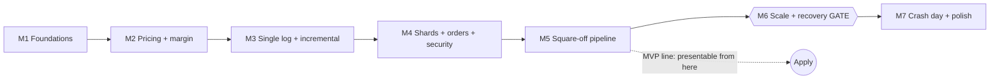

# Risk Engine — Build Map (v2)

A step-by-step map for building the Real-Time Margin & Risk Engine described in Build Plan v2. Work top to bottom. Each milestone ends in a **gate**, a check you must pass before moving on.

---

## 0. The map at a glance



| Milestone | Weeks (planned) | Weeks (realistic, with exams) | Gate |
| --- | --- | --- | --- |
| M1 Foundations | 1 | 1–2 | Clean `docker compose up`; seeded accounts reproducible |
| M2 Pricing + margin | 2–3 | 2–4 | Textbook prices; parity; hand-worked straddle matches |
| M3 Single log + incremental | 4 | 5–6 | Incremental = full; same log → same state hash |
| M4 Shards + orders + security | 5–6 | 7–9 | 0 mismatches over 1M events; 401/403/429/replay tests pass |
| M5 Square-off pipeline | 7 | 10–11 | 0 duplicate closes, 0 surplus legs, ledger balances |
| M6 Scale + recovery | 8 | 12 | p99 < 50 ms at 100k; kill -9 → identical hash |
| M7 Crash day + polish | 9–10 | 13–14 | Stranger runs one command, sees replay fire alerts |

**MVP line:** after M5 you have a correct, race-free engine with idempotent square-off. Put it on your resume then; M6 and M7 add the headline numbers and the demo.

---

## 1. Repo layout

```
risk-engine/
├── docker-compose.yml          # postgres, redpanda, redis, prometheus, grafana
├── host/                       # (added in M4) Redpanda EventLog, engine-out publisher, ShardHost
├── engine/                     # plain Java 21, no framework in hot path
│   ├── pricing/                # BlackScholes, Greeks, ScenarioGrid
│   ├── margin/                 # RiskArray, AccountVector, MarginCalculator
│   ├── shard/                  # ShardRunner, ShardState, Snapshotter
│   ├── squareoff/              # LegPlanner, InFlightTracker
│   └── events/                 # event records + deterministic serialisation
├── api/                        # Spring Boot order API (JWT, rate limit, validation)
├── writers/                    # engine-out → Postgres batch writers, outbox relay
├── broker-mock/                # chaos broker: timeouts, rejects, delays, dup fills
├── replayer/                   # historical minute replay + synthetic tick generator
├── loadtest/                   # Gatling/k6 scripts, JMH benchmarks
├── report/                     # crash-day report generator
├── web/                        # minimal alerts page (WebSocket)
├── db/migrations/              # Flyway SQL
└── docs/                       # architecture.md, decisions.md, results.md
```

Start `docs/decisions.md` on day one. Write one short entry every time you choose something (single log, outbox, greedy legs). That file becomes your interview prep.

---

## 2. Milestones

### M1 — Foundations

- [x] Repo, Gradle or Maven multi-module build, GitHub Actions running tests on every push
- [x] `docker-compose.yml` with Postgres, Redpanda, Redis
- [x] Flyway migrations for all tables in the v2 data model (`accounts` … `engine_snapshots`, including `outbox` and `audit_log`)
- [x] Create topic `engine-events` with N partitions (start N = 4) and topic `engine-out`
- [x] Instrument loader from NSE F&O bhavcopy, with lot sizes valid on the replay date
- [ ] Load Nifty minute bars and India VIX (intraday if available, else daily) into local files *(loader done; needs the raw data files, see `data/README.md`)*
- [x] Seeded account generator: futures-only, option buyers, short straddles/strangles, hedged spreads; some short sellers thinly funded
- [x] **Start-of-day state:** generator opens positions priced at the previous trading day's close (3 June 2024 for the replay), so the crash day starts from a believable book

**Gate:** `docker compose up` works on a clean machine; the same seed produces byte-identical account files.

### M2 — Pricing and margin (single-threaded, no Kafka yet)

> **Changes from the original plan** (agreed at M2 start): engine input goes through an `EventLog` interface (in-memory + file; Redpanda in M4), and **Nifty only until the end of M5**. One deviation, explained in decisions.md #23: net option value is subtracted from the requirement (NSE's form) rather than added to available margin.

- [x] `BlackScholes`: call, put, futures price; normal CDF implementation you can explain
- [x] Greeks: delta, gamma, vega, theta
- [x] Volatility inputs: Nifty = VIX ÷ 100 *(Bank Nifty ratio deferred until after M5)*
- [x] `ScenarioGrid`: 16 scenarios; price scan range per underlying in config; extreme multiple and coverage fraction from NSE Clearing parameters, in config *(values are guesses until checked)*
- [x] `RiskArray` per instrument, `AccountVector` per account
- [x] Margin = max(short-option minimum, worst scenario loss) + exposure margin
- [x] Long options: loss capped at premium; available margin includes net option value *(see note above)*
- [x] Utilisation and status thresholds (80 / 100 / 120%, N ticks) in config
- [x] Tests: JUnit textbook prices; jqwik properties (parity holds, margin ≥ 0, adding a hedge never raises margin)
- [x] Write a hand-worked short straddle example in `docs/` and assert the engine matches it
- [x] `EventLog` interface + in-memory and file implementations; single-threaded `ReferenceMarginEngine` reading from it

**Gate:** all pricing and margin tests green; hand example matches to the rupee.

### M3 — Single ordered log and incremental recompute

> Built on the `EventLog` interface (in-memory and file); Redpanda arrives in M4. Also done here, as follow-ups approved after M2: seed cash sized by the real margin engine, required margin clamped at zero, and futures P&L counted in available margin (decisions.md #30–#32).

- [x] Event types with deterministic serialisation (fixed field order, no hash-map iteration): `Tick`, `OrderRequest`, `Fill`, `SquareOffResult` *(orders and square-off results are accepted and ignored until M4 / M5)*
- [x] Replayer writes each tick to **every** partition with a global `tick_seq`; it is the only tick writer
- [x] `ShardRunner`: one thread reads one partition, applies events strictly in order
- [x] Shard-local pricing on each tick (no shared pricer)
- [x] `holders` reverse index and `byUnderlying` map
- [x] Delta update: `accountVector += qty × (newArray − oldArray)`
- [x] Full recompute every K ticks, assert drift within tolerance *(K = 100, tolerance one paisa; done as a rolling rebuild, 1% of accounts per tick, so no tick pays for the whole shard: decisions.md #38)*
- [x] Banned in shard code: `System.currentTimeMillis()`, `Random`, iterating unordered sets; use event timestamps and sorted collections *(enforced by `DeterminismRulesTest`)*
- [x] `stateHash()` over sorted shard state
- [x] JMH benchmark: naive vs incremental, per tick

**Gate:** incremental equals full on 10k random portfolios; running the same log twice gives identical hashes per shard; speed-up number recorded in `docs/results.md`. **Passed.**

### M4 — Shards, orders and security

> **Part 1 (done):** shards on Redpanda, the asynchronous order API, security. New `host` module (not in the layout above): Redpanda `EventLog`, `engine-out` publisher, one shard thread per partition. Accepted orders reserve margin until filled. See decisions.md #45–#61. **Part 2 (to do):** Postgres writers, the 1M-event stress harness, per-shard lag metric.

- [x] Partitioning: `hash(accountId) % N`; orders and fills keyed by account
- [x] Order API (Spring Boot) **is asynchronous:** it validates, writes `OrderRequest` to the account's partition, returns `202 Accepted` with an order id. The shard does the pre-trade margin check and emits accept/reject to `engine-out`; the client sees the result via `GET /orders/{id}` or WebSocket *(GET only so far)*. (Say this in the README; interviewers will ask how a pre-trade check works without locks.)
- [x] JWT with roles `trader` (own account only) and `risk-ops` (view all, block/unblock, manual square-off) *(risk-ops can view all orders; block/unblock and manual square-off wait for M5, when shards have account status)*
- [x] Redis token-bucket rate limit per user → 429
- [x] Request-id replay protection (Redis set with TTL) → reject repeats *(409, with the original order id)*
- [x] Input validation; parameterised SQL only *(no SQL exists yet; applies to part 2's writers)*
- [ ] `engine-out` topic; batched Postgres writers for positions, margin events, audit log *(shards publish to `engine-out`; writers are part 2)*
- [ ] Concurrency stress harness: interleave ticks, orders and fills on hot accounts; compare with a single-threaded reference run
- [ ] Per-shard lag metric

**Gate:** 1M interleaved events → 0 mismatches; security tests return 401, 403, 429 and replay rejection. *(Security half passed in part 1; the 1M-event half is part 2.)*

### M5 — Square-off pipeline

- [ ] Status state machine using **expected** utilisation (subtract in-flight legs' expected release)
- [ ] `InFlightTracker`: record leg before emitting; key `accountId:episodeId:instrumentId:seq`
- [ ] Greedy `LegPlanner`: most margin released per lot, short options first, re-plan after each leg
- [ ] Writer inserts order + outbox row in one transaction; relay sends unsent outbox rows
- [ ] Mock broker chaos: 5% timeouts, 2% rejects, delayed fills, 10% duplicate callbacks; idempotent on key
- [ ] Timeout handling: query broker by key before retrying
- [ ] Reject handling: drop from in-flight, next tick re-plans with `seq + 1`
- [ ] Fills: broker callback → `engine-events` (account's partition); shard dedupes with `seenFillIds`; Postgres unique `broker_fill_id`
- [ ] Double-entry ledger for every fill and margin movement
- [ ] Audit log row for every square-off decision

**Gate:** under full chaos, 0 legs closed twice, 0 surplus legs while one is in flight, every ledger `txn_id` sums to zero.

> **MVP line.** Resume-ready from here. Update README with what works and the numbers so far.

### M6 — Scale and recovery (go/no-go)

- [ ] Synthetic tick generator at 10, 50, 100 ticks/s
- [ ] Gatling or k6 order traffic in parallel
- [ ] 100k accounts, ~5 positions each
- [ ] Prometheus metrics: tick-to-margin latency histogram, per-shard lag, ticks/s; Grafana dashboard
- [ ] Snapshots every M seconds of **log time**: state, partition offset, state hash
- [ ] Recovery: load snapshot, replay from offset; re-emitted square-offs carry same keys and are dropped by the unique constraint
- [ ] `kill -9` script mid-run; compare final hash with uninterrupted run; count broker calls

**Gate:** p99 < 50 ms at 100k accounts with sustained ticks/s published; recovery hash identical; 0 duplicate broker orders. If p99 fails, profile (allocation in hot path, boxing, GC) before going further.

### M7 — Crash day and polish

- [ ] Replay 4 June 2024 against the seeded book
- [ ] Report: Nifty + VIX chart with call/square-off markers; counts by account type; 5 worst accounts with timelines; busiest-minute latency; state whether VIX was intraday or daily
- [ ] Verify index and VIX moves against NSE data before quoting numbers
- [ ] Minimal WebSocket alerts page
- [ ] README in the v2 structure; 60-second demo GIF
- [ ] Deploy (a single small VM running Compose is enough)

**Gate:** a stranger clones, runs one command, watches alerts fire.

---

## 3. Cut order if time runs short

1. Web UI
2. Greeks dashboard
3. Bank Nifty
4. Crash recovery

Never cut: concurrency test, idempotent square-off, security basics, load-test numbers.

---

## 4. Results to collect

See [results.md](results.md).
